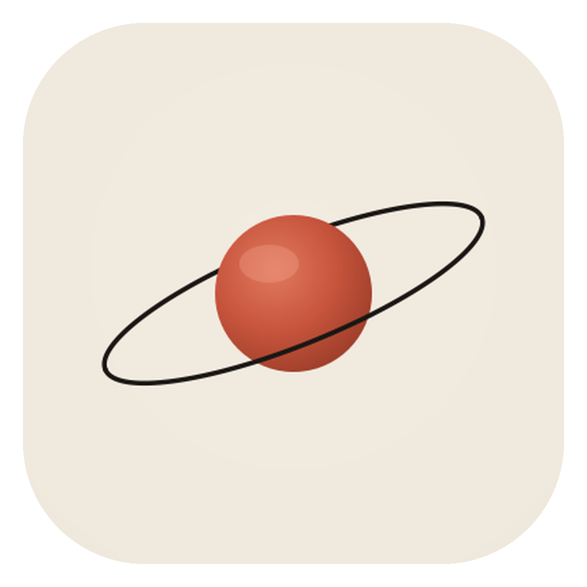

<p align="center">
  
</p>

<h1 align="center">Orbix Core</h1>

<p align="center"><strong>A local-first work OS: talk to Bob, and the work gets done on your machine.</strong></p>

<p align="center">
  <a href="https://github.com/asworbix/orbix-core/actions/workflows/ci.yml"></a>
  <a href="LICENSE"></a>
  
</p>

Orbix Core is a desktop app built around **Bob**, an agent that runs on a local Gemma 4 or Qwen 3 model, calls real tools (your files, shell, apps, calendar, mail, the web), and turns what it learns into workflows, agents, documents, and panels. The model, speech-to-text, and text-to-speech all run on your machine. The cloud is an explicit, redacted exception, never the default.

Orbix Core runs on macOS and Windows from one codebase, with platform code kept behind compile-time switches. Linux is next: [docs/platforms.md](docs/platforms.md).

> Reliable AI. Fraction of the cost. Your data stays on your machine.

## Why Orbix Core instead of another local AI app

Most local AI apps are a chat window in front of a model. Orbix Core is an agent runtime: native tool calling verified per model, durable workflows that resume after a crash, sandboxed and signed connectors, direct bridges into the apps you already use, and a single audited egress gate for the rare call that leaves the machine. The point is not to chat with a model; it is to hand work to one and have it done.

## Screenshots

_Coming with the first release: chat with Bob, Imagine, the workflow builder, voice mode._

## What it does

- **Bob, hands-free.** Ask by text or voice. Bob reads your calendar rather than asking what is on it, lists the folder rather than asking what is in it, and reports what it did in one line.
- **Imagine.** One click, no request: Bob looks at what is open on your computer, reads what matters, and makes one real thing: a briefing, a panel, a document, an interactive page, a workflow, a skill. Nudge him while he works; the result lands in the chat.
- **Native tool calling, verified per model.** Bob calls tools through the model's own tool-calling format and reads results back as native tool turns. Every shipped model passes the same tool-calling gate before it enters the catalog.
- **Durable workflows.** Every execution is a resumable run with a persisted per-step log. Kill the app mid-run and it continues where it left off.
- **Agents as employees.** Hire an agent with a charter and a tool grant; it works shifts on a schedule and reports to your inbox.
- **Run monitor.** A small window beside the app with the live log of everything a run does: every step, tool call and its result, model turn, egress decision, and error, for Bob, Imagine, agent shifts, and workflows. Stop or steer the run from there.
- **App bridges.** Reads Calendar, Mail, Outlook, Notes, Reminders, and Messages through their scripting interfaces (on Windows: classic Outlook, through COM), and any visible window through Accessibility (UI Automation on Windows). No account setup.
- **Self-building connectors.** Bob can author a sandboxed Deno connector from a spoken request, then scan, sign, and activate it. Modules run with kernel-enforced host and env allowlists.
- **Documents and panels.** Branded Word, PowerPoint, HTML, website, and interactive single-page outputs, plus live UI panels Bob builds from real data.
- **Voice.** Local whisper speech-to-text with live partial transcripts and local neural text-to-speech.
- **Terminal CLI.** `orbix` (alias `bob`) drives the same local runtime from the shell.
- **Secure by default.** Secrets encrypted with AES-256-GCM under a key in the OS credential store. Cloud egress redacted and gated by a compliance policy, with a hash-chained audit log.

## Local-first, on purpose

The default model, STT, and TTS run on your machine. No account is required to use the app. Nothing leaves the machine unless a tool sends it, and the tools that can send are few, visible, and gated. [docs/privacy.md](docs/privacy.md) lists every exit.

## Platforms and hardware

| Platform | Status |
|---|---|
| macOS 13+ (Apple Silicon) | Supported. Signed and notarized. App bridges: Calendar, Mail, Outlook, Notes, Reminders, Messages |
| Windows 10/11 (x64) | Supported. Installer not code-signed. App bridge: classic Outlook; GPU acceleration through CUDA or Vulkan |
| Linux (x64) | Next |

Details, the shared-versus-platform-specific matrix, and how to help with a port: [docs/platforms.md](docs/platforms.md).

- **Memory decides the model.** Orbix picks the best model your machine can run comfortably and refuses ones that would load and then fail. On a Mac that is unified memory; on Windows it is graphics memory when a CUDA or Vulkan GPU is found, system memory otherwise.

| Memory | Comfortable models |
|---|---|
| 8 GB | Gemma 4 E2B, Qwen3.5 4B |
| 16 GB | Gemma 4 E4B (default), Gemma 4 12B, Qwen3.5 9B |
| 32 GB | Gemma 4 26B-A4B |
| 48 GB and up | Gemma 4 31B, Qwen3.6 27B, Qwen3.6 35B-A3B |

- **Disk.** 3 to 22 GB per model, plus about 0.5 GB for the speech models. Everything downloads on first use into the app data folder (`~/Library/Application Support/ai.orbixcore.app/` on macOS, `%LOCALAPPDATA%\ai.orbixcore.app\` on Windows).

## Install

**From a release:** download the Mac DMG or the Windows installer from [Releases](https://github.com/asworbix/orbix-core/releases) or [orbixcore.ai/download](https://orbixcore.ai/download). The Mac app is signed and notarized. The Windows installer is not code-signed yet, so SmartScreen may ask you to confirm (More info, then Run anyway).

**From source:**

```bash
# Prerequisites: Rust (stable), Node.js 18+, and the platform toolchain
# (Xcode command line tools on macOS, VS Build Tools with C++ on Windows); see docs/platforms.md
git clone https://github.com/asworbix/orbix-core.git
cd orbix-core/orbixcore
npm install
npm run tauri dev
```

`npm run tauri:build` produces a release bundle; it stages the CLI and the Swift speech helper first.

## Quick start

1. Open the app. It picks a model that fits your computer and downloads it (Gemma 4 E4B on a 16 GB machine, about 5 GB).
2. Type or say: `what is on my calendar today`. On a Mac, macOS asks the first time whether Orbix Core may control Calendar; allow it. On Windows, Bob reads classic Outlook; with the new Outlook, connect a Microsoft account instead.
3. Click the sparkle next to the input, or type `imagine`. Bob looks around and makes something.
4. Say `every weekday at 8, read my calendar and mail and write me a briefing`. Bob creates the workflow; it appears in Build and runs on schedule.

### Local model setup

Settings > Models lists the curated Gemma 4 and Qwen 3.x models with a fit label for this computer (great, ok, tight, too big). Pick one and it downloads with resume support; vision projectors are a separate one-click download. Any other GGUF can be added from a HuggingFace repo. Models never leave the machine and can be deleted from the same screen.

### Example workflow

```text
Name      Morning briefing
Trigger   weekdays 08:00
Step 1    action   app_bridge  Calendar.upcoming_events {days: 1}
Step 2    action   app_bridge  Mail.recent_messages {limit: 10}
Step 3    prompt   "From the calendar and mail above, write a five-line briefing:
                    what is first, what needs a reply, what can wait."
```

Steps gather with tools; the model reasons over a small, real slice. That is the pattern everywhere in Orbix Core.

## Architecture

```
orbixcore/            Tauri desktop app
  src/                React + TypeScript front end
  src-tauri/src/      Rust backend: Bob, model engine, workflows, tools, connectors, egress, storage
bob-cli/              The orbix terminal CLI (bob is an alias)
browser-extension/    "Send to Orbix": ship a plan from Claude.ai or Copilot to your computer
marketplace/          Community skills, workflows, paired apps and connectors (orbixcore.ai/marketplace)
docs/                 Architecture and privacy
```

[docs/architecture.md](docs/architecture.md) walks through the Tauri shell, the agent loop, the model lifecycle, context handling, tool execution, storage, encryption, and the security boundaries, with diagrams.

An iOS companion app and a small OAuth relay exist as private repositories for now.

## Bring your own credentials

Orbix ships **no** shared OAuth credentials. To connect Microsoft, Google, GitHub, Slack, or LinkedIn, register your own OAuth app and add its client ID:

```bash
cp orbixcore/src-tauri/credentials.example.json orbixcore/src-tauri/credentials.json
```

`credentials.json` is gitignored. Local models need no credentials at all.

## Project status

**Developer Preview (v0.1.x).** The core loop, workflows, agents, bridges, voice, and connectors work daily on the maintainer's machines. Expect rough edges, breaking changes to on-disk formats between minor versions, and a small model that occasionally needs a second ask.

### Known limitations

- On Windows the one app bridge is classic Outlook (the new Outlook has no scripting interface, so there mail and calendar go through a connected account); macOS has six. Linux is not started. See [docs/platforms.md](docs/platforms.md).
- The Windows installer is not code-signed yet, so SmartScreen asks for confirmation on first run.
- Browser driving needs Chrome started with `--remote-debugging-port=9222`.
- Small models (E2B, 4B) are fast but less reliable at multi-step tool use; 16 GB and the E4B or 9B models are the comfortable floor.
- Voice is English-first.
- The `shell_exec` tool is powerful by design: read what Bob is about to run.

### Roadmap

- More app bridges on Windows, then Linux.
- Code signing for the Windows installer.
- More app bridges and window intelligence.
- The iOS companion as a public remote control.
- Adaptive model work: smaller, faster local models for the agent loop.

## Contributing

See [CONTRIBUTING.md](CONTRIBUTING.md) for setup, checks, and conventions. Bugs and ideas go to [Issues](https://github.com/asworbix/orbix-core/issues); questions to Discussions. Security problems: [SECURITY.md](SECURITY.md).

## License

Apache License 2.0. See [LICENSE](LICENSE). Bundled and downloaded third-party components keep their own licenses; see [orbixcore/src-tauri/THIRD_PARTY.md](orbixcore/src-tauri/THIRD_PARTY.md).

Orbix Core, Orbix, and the Orbix logo are trademarks; the license does not grant rights to them. See [TRADEMARKS.md](TRADEMARKS.md).
