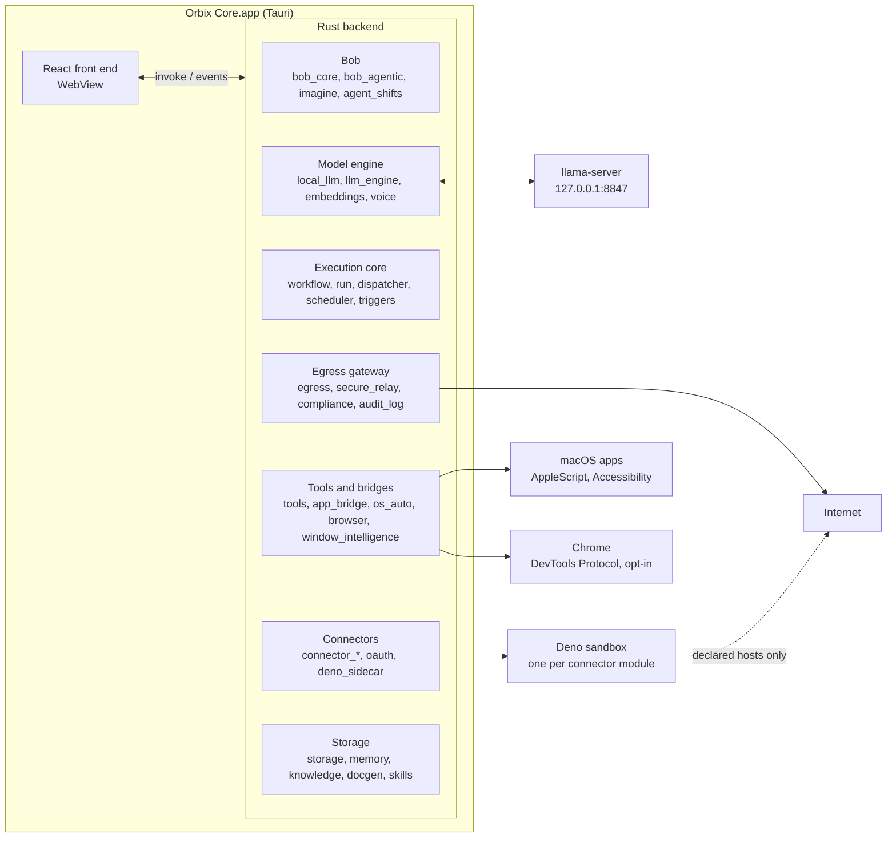
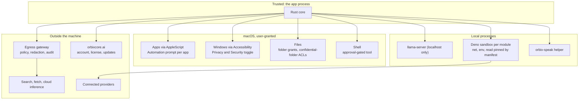

# Architecture

Orbix Core is a desktop app: a Rust backend inside a Tauri shell, a React front end in the WebView, and a local `llama-server` process that runs the model. Bob, the assistant, is the product surface. Everything else exists so that Bob can read, decide, and act on this machine.

macOS is the reference platform; Windows and Linux share the same code with a thin platform layer (see [platforms.md](platforms.md)). This page describes the shared design and names the macOS implementation where a platform layer exists.

## The big picture

## Desktop shell (Tauri)

- One main window plus the **Run monitor**, a small free-standing window (label `monitor`) that opens beside it when an agent starts a shift (Settings can turn the automatic pop-up off) and on demand from the command palette, the context menu, the Agents panel, or by telling Bob "open the monitor". It remembers where you leave it.
- The front end talks to Rust through Tauri commands (`invoke`) registered in `src-tauri/src/handler.rs`, and Rust talks back through events (`message-chunk`, `bob-step`, `new-message`, `data-changed`, `shift-*`, `imagine-*`). `event_bus::emit_ui` emits to every window and mirrors each event onto an internal core bus so backend modules can react too.
- Filesystem, shell, and dialog permissions are declared in `src-tauri/capabilities/default.json`.

## Front end

React + TypeScript, built with Vite, in `orbixcore/src/`.

- `App.tsx` owns the shell: the Run tab (chat with Bob) and the Build tab (workflows, agents, connectors), lazy-loaded panels, toasts, streaming state.
- `hooks/api.ts` is the single typed surface over `invoke` and `listen`. Components never call Tauri directly.
- `ChatInput` and `ChatHistory` are the primary surface; `Imagine` is the free-rein overlay; `RunMonitor` renders in the monitor window.
- Panels exist for inspection and editing, but every capability is also reachable through Bob's tools, so the app can be driven by voice alone.

## Bob and the agent runtime

A turn enters through `bob_core::bob_send`:

1. **Router first.** `router::try_route` handles deterministic commands ("list agents", "run workflow X") with no model call.
2. **Agentic loop.** Everything else runs `bob_agentic::run_loop`: the model is advertised Bob's native tool catalog, streams a reply, every tool call is executed, results go back as `role: tool` turns in the exact shape the model's chat template expects, and the loop continues until the model produces a turn with no calls (at most 10 turns, or until the user presses Stop).
3. **Cleanup.** The final text is stripped of machinery, a step trail (`[[steps:...]]`) and any artifact chips (`[[doc:...]]`, `[[panel:...]]`) are attached, and the reply is stored with an evidence digest of real tool output so follow-up turns build on facts rather than memory.

Every run, whatever started it, also writes to the **run log** (`run_log.rs`): run started and ended, each step label, each tool call with its outcome and a capped excerpt of the result, each model turn (chars, calls, seconds), each egress decision, each error, each message the user sent mid-run. Entries attach to a run id (the task's step scope for shifts and Imagine, the active chat turn or workflow run otherwise), a ring buffer keeps the last 2,000 so a monitor opened mid-run backfills, and the Run monitor window renders the stream live with Stop and steer for the run in progress. The log is a side channel: it never blocks or fails a run.

The same loop powers two more things:

- **Agent shifts** (`agent_shifts`): an agent with a charter works a shift on exactly the tools it was granted, with its own stop flag and inbox (`shift_monitor::ShiftControl`) so stopping Bob never kills a shift and vice versa.
- **Imagine** (`imagine`): a run with no request. Bob scans what is open, reads what matters, and makes one real thing. The catalog is filtered by policy (`tool_schemas::is_outward_tool`, `is_disruptive_tool`): nothing that sends, posts, connects, deletes, or fires the user's automations.

The tool catalog lives in `tool_schemas::bob_tools()` as OpenAI-style function schemas. `llama-server` parses the model's calls server-side (jinja chat templates) and streams them as `delta.tool_calls`; `is_known_tool` guards against invented names, and an unknown or malformed call is fed back to the model as an error rather than dropped.

## Local inference and the model lifecycle

- **Catalog.** Two families, Gemma 4 and Qwen 3.x, as GGUF files with exact byte sizes (`local_llm.rs`). Every curated model is multimodal; the vision projector (`mmproj`) is a separate optional download. Any other GGUF can be added from a HuggingFace repo.
- **Fit.** Before recommending or loading, the app compares what a model needs (weights x1.15 for KV cache and buffers) with what Metal can give it (about 70% of unified memory) and classes it great / ok / tight / too big. Too-big models are refused at launch instead of loading and then failing on the first token.
- **Server.** A pinned `llama-server` build is fetched on first use into the app's `bin/` folder and started lazily on `127.0.0.1:8847`. A busy guard keeps it alive across a whole tool-using run; an idle timer unloads it after 3 minutes (10 in a voice conversation). A dead server is restarted, never left for the user to diagnose.
- **Voice.** Speech-to-text with whisper.cpp, text-to-speech with Kokoro plus a small Swift AVSpeechSynthesizer helper, all local. Partial transcripts stream while you talk.
- **Embeddings.** A small Qwen3 embedding model backs memory search and the knowledge base.

## Context handling and token discipline

Local models are fast only when the prompt is stable and small. The rules the code follows:

- **Static prefix, cached.** The system message (`llm_engine::bob_system_message`) is byte-identical across turns: the contract plus a profile block (name, up to 20 memory lines capped at 200 characters each, connected services, working folder, installed skills, app-bridge capabilities). With `cache_prompt` the server reuses its KV cache for the whole prefix and the tool schemas.
- **Dynamic context in the user turn.** What changes turn to turn (clock, agents, workflows, today's calendar digest, a 1,200-character knowledge slice) is prepended to the current user message, not the system prompt, so the cached prefix survives.
- **Capped results.** Tool output shown to the model is capped per result; the run's evidence digest is capped at 6,000 characters and rides only on the newest four assistant turns.
- **History to budget.** Older turns are trimmed to fit the context window before every request.
- **Thinking off by default.** Measured on Gemma 4 E4B and Qwen3.5 9B: with hidden reasoning on, a simple tool call spent its whole budget reasoning and emitted nothing; off, the same calls returned correct in a fraction of the tokens. The loop itself is the reasoning: observe a result, act again.
- **Gather with actions, decide with the model.** Workflows fetch data through direct tools and APIs and hand the model a small structured slice to reason over. Large payloads never pass between steps.

## Tool execution

- **Built-in tools** (`tools.rs`): `file_read`, `file_write`, `file_edit`, `file_list`, `shell_exec` (runs in the workspace folder unless a `cwd` is passed), `web_fetch`, `web_search`. File tools go through path guards that enforce confidential-folder ACLs (`data_control`) and log access.
- **First-class actions** (`llm_engine::execute_actions_counted`): create and run workflows, hire agents, remember and search memory, read Mac apps through bridges (`app_bridge`: Calendar, Mail, Outlook, Notes, Reminders, Messages), read any window via Accessibility (`read_app_window`), drive Chrome, research a topic, create documents (`docgen`: docx, pptx, html, website, interactive app page), build UI panels, load skills, connect services.
- **Fallback parsing.** Models that write `<action>{json}</action>` tags instead of native calls are still executed through the same path; residual tags never reach the display.
- **Approval and scope.** The shell tool is approval-gated in the registry; agent shifts see only their granted tools; Imagine sees a policy-filtered catalog.

## Execution core

- **Workflows** are ordered steps of two kinds: `prompt` (the model runs the full instruction) and `action` (a tool with arguments, a connector, or a shell command). Triggers are manual or scheduled (cron or keywords).
- **Durable runs.** Every execution is a `Run` with a persisted per-step log. Kill the app mid-run and it resumes where it stopped. One scheduler feeds one queue; scheduled shifts run sequentially so a fleet waking at once never contends for the one local model.
- **Triggers and pipelines** turn external events (mail, calendar, webhooks, file changes) into runs, and orchestrator chains route work between agents.

## Connectors

A connector is a sandboxed Deno module with a manifest that declares its allowed hosts and environment keys.

- At activation the module is AST-scanned: any host or env key reached in code but not declared fails activation.
- Every module is Ed25519-signed; unsigned or tampered modules are refused unless the developer override `ORBIX_ALLOW_UNSIGNED_MODULES=1` is set.
- At runtime the module runs as a Deno subprocess with `--allow-net` pinned to its hosts, `--allow-env` to its keys, and `--allow-read` to its own folder. The Deno binary itself is downloaded on first use and checksum-verified.
- OAuth uses the native-app loopback flow with the user's own registered client IDs; Orbix ships no shared credentials. Bob can author, scan, sign, and activate a new connector from a spoken request.

## Platform layer

Everything above is platform-neutral. The parts that touch the operating system are a thin layer, one module per concern, gated with `#[cfg(target_os = "...")]`:

| Concern | Module | macOS | Windows |
|---|---|---|---|
| System voice | `voice.rs` | `orbix-speak` (AVSpeechSynthesizer) | SAPI via PowerShell |
| App control, clipboard, system info, notifications | `os_auto.rs`, `notifications.rs` | AppleScript | PowerShell, Win32, WinRT toast |
| Shell tool and child processes | `tools.rs`, `process_ext.rs` | `/bin/sh` | `cmd.exe`, no console window |
| Window reading and field automation | `window_intelligence.rs` | Accessibility (`ax`) | UI Automation (`uia`) |
| Front app, browser URL, screenshots | `screen_capture.rs` | CoreGraphics, AppleScript | Win32, UIA, `System.Drawing` |
| App bridges | `app_bridge.rs`, `resources/bridges/` | AppleScript bridges | none yet (not offered to the model) |
| Model server binary and memory query | `local_llm.rs` | Metal build | CUDA, Vulkan, or CPU build, picked per machine |
| Master key store | `storage.rs` | Keychain | DPAPI-wrapped key file |

Each implementation returns the same JSON shape, so the front end never branches on platform. A capability a platform lacks returns a clear error rather than a fake result. Full status and the Linux plan: [platforms.md](platforms.md).

## Storage and encryption

Everything lives under the app data folder (`~/Library/Application Support/ai.orbixcore.app/` on macOS, `%LOCALAPPDATA%\ai.orbixcore.app\` on Windows; `ORBIX_DATA_DIR` relocates it, and the test suite uses a temp folder):

| Path | What |
|---|---|
| `models/`, `bin/` | Downloaded GGUF models and projectors, the `llama-server` and `deno` binaries |
| `profiles/<id>/` | One workspace profile: conversations, workflows, agents, memory, skills, panels, audit log (the default profile is the base folder itself) |
| encrypted files | Connector credentials, the module signing key, the optional account token |

Secrets are encrypted with AES-256-GCM under a per-install 32-byte master key that lives in the macOS Keychain; the app never writes them to disk in plaintext. Conversations, workflows, and memory are plain JSON files, protected by the user's disk encryption (FileVault). The audit log is hash-chained so tampering is detectable. Generated documents go to `~/Documents/Orbix Documents/` (Imagine writes loose files under `Imagine/` there).

## Optional cloud

By default nothing leaves the machine. The exits that exist, all opt-in:

- **Cloud inference.** An agent created with provider `anthropic` and the user's own API key calls `api.anthropic.com`, or Vertex AI in the EU when configured, through the egress gateway.
- **Web.** `web_search` (DuckDuckGo) and `web_fetch` go through the same gateway.
- **Connectors** talk to the providers the user connected, from inside their sandbox.
- **Updates.** The update check talks to `orbixcore.ai` directly (plain HTTPS, not through the gateway). There are no accounts or license keys.

The egress gateway (`egress.rs`) is the one door for search, fetch, and cloud inference: it applies the workspace compliance policy (residency and boundary gates), runs the redaction engine (PII stripping), and records every decision in the audit log. A fresh install ships strict: compliance on, redaction strict, residency hard-gated.

See [privacy.md](privacy.md) for the full list of what can leave the machine and when.

## Security boundaries

## Related projects

- **iOS companion** (private repository for now): pairs with the desktop app over the local mobile API and acts as a remote control.
- **Auth relay** (private): a small OAuth token-exchange service for providers that require a client secret. Not needed by any current connector.
- **Belemnite** is a separate, public project: scraper-poisoning middleware for the web, which protects the orbixcore.ai site. Orbix Core has no code dependency on it, does not bundle it, and never calls it; the two share a maintainer, nothing else.
